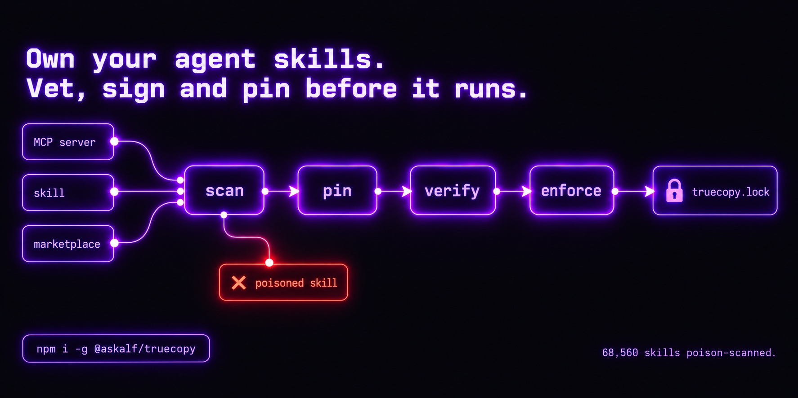

<div align="center">



# truecopy

### The supply-chain gate for agent skills and MCP servers.

<p>
  <a href="https://www.npmjs.com/package/@askalf/truecopy"></a>
  <a href="https://github.com/marketplace/actions/truecopy-gate-your-agent-skills"></a>
  <a href="https://github.com/askalf/truecopy/blob/watch/WATCH.md"></a>
  <a href="https://github.com/askalf/truecopy/actions/workflows/ci.yml"></a>
  <a href="https://scorecard.dev/viewer/?uri=github.com/askalf/truecopy"></a>
  <a href="https://www.bestpractices.dev/projects/14488"></a>
  <a href="https://github.com/askalf/truecopy/blob/master/LICENSE"></a>
</p>

<sub><b>68,560 skills poison-scanned</b> · the official Claude Code plugin directory re-scanned every day · deterministic and offline · one runtime dependency · MIT</sub>

<sub><a href="#see-it-catch-one">See it</a> · <a href="#quick-start">Quick start</a> · <a href="#the-attack">The attack</a> · <a href="#how-it-works">How it works</a> · <a href="#what-it-gates">What it gates</a> · <a href="#in-ci">In CI</a> · <a href="#proven-at-ecosystem-scale">Proof</a> · <a href="#trust-and-transparency">Trust</a> · <a href="#docs">Docs</a></sub>

</div>

---

An agent runs its tools with your privileges, and it believes what their descriptions tell it. **truecopy is the supply-chain gate in front of those tools.** It poison-scans a skill or MCP server before you trust it, pins exactly the bytes you vetted into `truecopy.lock` (signed, if you want to know who vetted them), re-checks every pin on every run and every CI pass, and enforces the lock at runtime. A poisoned tool is refused at the door; a tool you trusted last week that quietly changed is stopped before the agent ever sees it.

## See it catch one


That picture is a recording, not a mock-up. [`scripts/readme/terminal.mjs`](scripts/readme/terminal.mjs) runs each command with this checkout's CLI in a throwaway directory, against the two manifests in [`demo/`](demo/), and refuses to redraw it if any verdict or exit code changes.

## Quick start

```bash
npm i -g @askalf/truecopy                  # Node 20 or newer

truecopy scan ./mcp-server.json            # poison-scan it before you trust it
truecopy add  ./mcp-server.json --sign     # pin the vetted bytes into truecopy.lock, signed
truecopy verify                            # re-check every pin; exit 1 on drift or poison
```

Commit `truecopy.lock` next to your code, the way you commit `package-lock.json`. Then choose where it is enforced:

```bash
# Claude Code: pin every skill, then check each one at the moment it is invoked
truecopy add --claude --claude-plugins --sign && truecopy hook install

# any MCP client: launch the server through the proxy; only pinned, unchanged tools get through
truecopy-mcp --lock truecopy.lock --name filesystem -- <server command>

# any process: refuse to launch while a pin is bad
truecopy guard -- npm start
```

No install needed for a one-off: `npx -y @askalf/truecopy verify`. In a clone, `npm run demo` plays the whole story offline.

## The attack

Agents pull tools from places you do not control: MCP servers, skill marketplaces, a teammate's repo. OpenClaw's poisoned-skills marketplace showed what that costs. Three things go wrong, and truecopy answers each one:

| The attack | What it looks like | What truecopy does |
|---|---|---|
| **Tool poisoning** | A description, schema or `SKILL.md` that tells the model to *"ignore previous instructions"* and send `~/.ssh/id_rsa` somewhere. The model reads it as an instruction; you never read it at all. | `scan` flags injection and exfiltration instructions in every name, description, schema and skill file, and `add` refuses to pin a poisoned one. |
| **The silent update** | A server or skill you vetted last week ships new bytes. No diff you will ever read shows it, and the agent loads it on the next run. | Every pin records a content hash plus one hash per tool or file. `verify`, the hook, the proxy and `guard` re-derive them and fail on any change, naming what changed. |
| **The wrong signer** | Someone substitutes the lock entry, or signs a tampered version with a key of their own. | Ed25519 signatures are checked against your trust set: your machine's own key, the keys you trust globally and the `truecopy.trust` you commit. A valid signature from a key you do not trust fails closed as `untrusted`; `--require-signed` fails anything unsigned. |

## How it works

| Stage | Command | What happens |
|---|---|---|
| **scan** | <code>truecopy&nbsp;scan</code> | Deterministic poison detection over everything the model will read. Prose in skills is severity-aware: an *instruction* flags, a mere *mention* of a secret path is an advisory. Tool definitions keep the strict any-finding rule. |
| **pin** | <code>truecopy&nbsp;add</code> | The vetted version goes into `truecopy.lock`: source, content hash, per-part hashes, the verdict and detection engine version at pin time, and optionally an Ed25519 signature. |
| **verify** | <code>truecopy&nbsp;verify</code> | Every run or CI pass re-hashes and re-scans every pin. Changed bytes are `drifted`; unchanged bytes that newer detection now flags are `poisoned`. Exit 1 on any failure. |
| **enforce** | hook&nbsp;·&nbsp;proxy&nbsp;·&nbsp;guard | The [runtime gate](docs/runtime-gate.md) keeps an unvetted or drifted tool from reaching the agent at all: the Claude Code hook, the `truecopy-mcp` proxy, and the `guard` launch gate. |

A lock entry, as committed in this repo's own [`truecopy.lock`](truecopy.lock):

```json
"filesystem": {
  "source": "demo/clean-mcp.json",
  "kind": "mcp",
  "hash": "a881946cef3fb45d7c78d3297070a179f4c55ba65f00a576ada922c39f4e1f57",
  "scannedAt": "2026-07-16T17:25:56.559Z",
  "verdict": "clean",
  "findings": 0,
  "detection": { "engine": "redstamp", "version": "0.4.1" },
  "parts": {
    "read_file": "cfe9acc21dbc05b0b8baa751e71fe524fd8fa15578d20610fc90b8d533bd8d8f",
    "list_directory": "ac606087a4a47e23d801beb12699d87364430677f04b6709eacbaec062156227",
    "(manifest)": "cac4676bf307456c45dfa470fa0b350b6b305b0d3cb86ffc3b68396625261b46"
  }
}
```

`parts` is why a failure can name `~read_file` instead of just saying something changed: one hash per tool for an MCP server, one per file for a skill, and one for the manifest's own fields, so a swapped launch command is caught too. Paths in the lock are separator-independent, so a lock committed on one OS verifies on another.

<details>
<summary><b>Every verdict <code>verify</code> can return</b></summary>

<br>

| Status | Meaning | Fails? |
|---|---|---|
| `ok` | Same bytes as the pin, still scans clean (or carries findings you accepted for exactly these bytes with `--force`), and any signature is valid from a trusted key. | no |
| `drifted` | The bytes changed since the pin. Lists the tools or files added, removed or changed. | yes |
| `poisoned` | Same bytes, but they now scan poisoned: detection improved after you pinned. | yes |
| `untrusted` | A valid signature from a key outside your trust set. | yes |
| `unsigned` | An entry recorded as signed whose signature no longer checks; or, under `--require-signed`, any entry without a trusted signature. | yes |
| `missing` | The pinned source cannot be read. | yes |

Exit codes: `0` when every pin is `ok`, `1` on any failure. The Claude Code hook blocks with exit `2` and tells the model why. `scan`, `verify`, `list` and `diff` take `--json` with the same exit codes.

</details>

## What it gates

| Surface | Checked | A bad pin |
|---|---|---|
| **Claude Code skills**<br>project, user and marketplace plugins<br><code>hook&nbsp;install</code> | The moment a skill is invoked, against the exact directory about to run | Blocked, and the model is told the skill drifted or turned poisonous. <code>--strict</code> makes the lock a whitelist that fails closed. [More](docs/claude-code.md) |
| **MCP servers**<br>any client that launches stdio servers<br><code>truecopy-mcp</code> | Every <code>tools/list</code> response, and every call against it | Stripped from <code>tools/list</code>, and a call to it errors. <code>--strict</code> blocks the whole server. [More](docs/runtime-gate.md) |
| **Process launch**<br><code>guard&nbsp;--&nbsp;&lt;cmd&gt;</code> | Before the command starts | The command never starts; exit 1. |
| **CI**<br><code>askalf/truecopy-action@v1</code> | Every workflow run | The build fails. [In CI](#in-ci) |
| **Plugins already installed**<br><code>check-manifest</code> | On demand, against the daily watch | Fails when an installed skill's bytes differ from what the watch vetted, or the watch flagged it. [More](docs/watch.md) |
| **A marketplace before you install**<br><code>scan&nbsp;--marketplace</code> | On demand, against your clone | Every flagged skill is listed; exit 1. |

What you can pin: an **MCP manifest** (a `.json` holding the server's `tools` array, the shape `tools/list` returns; its other top-level fields, such as the launch `command` and `args`, are hashed and scanned too), a **skill directory** (`SKILL.md` plus its files, hashed per file), or **any single file**.

## In CI

One line from the [GitHub Marketplace](https://github.com/marketplace/actions/truecopy-gate-your-agent-skills) verifies the committed lock and fails the build on drift or poison:

```yaml
- uses: askalf/truecopy-action@v1
```

Or scan a marketplace or manifest with no lock at all:

```yaml
- uses: askalf/truecopy-action@v1
  with:
    command: scan
    marketplace: ./the-repo-you-cloned
```

Where trust matters, require a signature from a publisher you trust, and keep the one private signing key in a single CI secret instead of on every laptop:

```yaml
# every pin must carry a valid signature from a key in the runner's trust set
- run: npx -y @askalf/truecopy verify --require-signed

# sign with the CI secret: no key file and no keychain on the runner
- run: npx -y @askalf/truecopy add ./mcp-server.json --sign
  env:
    CANON_SIGNING_KEY: ${{ secrets.CANON_SIGNING_KEY }}
```

On a workstation the trust set is your machine's own key, the keys you trust globally and the repo's `truecopy.trust`. A clean runner has no key and no global store, so there it is `truecopy.trust` alone: commit every publisher's public key to it, the public half of `CANON_SIGNING_KEY` included. That key signs but is never trusted just for being set.

Publisher keys, the committed `truecopy.trust`, JSON reports and the signing setup: [docs/signing-and-ci.md](docs/signing-and-ci.md). This repo runs the same gate on itself in [`truecopy-gate.yml`](.github/workflows/truecopy-gate.yml).

## Proven at ecosystem scale

| Corpus | Skills | Result |
|---|---:|---|
| The official Claude Code plugin directory plus nine community marketplaces | 2,019 | **0 poisoned.** Tuning detection against this corpus took the flag rate from 126 to 12 (0.6%), and every one of the 12 was benign on manual review. |
| ClawHub, the registry whose poisoning incident started the category | 66,541 | **0 confirmed malicious.** 813 deterministic alarms, every one benign on cross-check against ClawHub's own scanner. |
| The official directory, re-scanned every day | 2,471 | The 2026-10-29 run covered 315 plugins: **0 under review**, 463 advisories. The watch badge above always carries the latest run. |

The daily watch fetches every catalog plugin, including vendor plugins at their catalog-pinned commits, and publishes each snapshot to [`WATCH.md`](https://github.com/askalf/truecopy/blob/watch/WATCH.md) and the **[live observatory at truecopy.sprayberrylabs.com](https://truecopy.sprayberrylabs.com)**. Each run also publishes a [`directory-manifest.json`](https://github.com/askalf/truecopy/blob/watch/directory-manifest.json) of the exact bytes it vetted, so `truecopy check-manifest` can hold the plugins on your own machine to the same standard.

## Trust and transparency

A supply-chain gate has to survive the scrutiny it applies to others.

| Promise | How it holds |
|---|---|
| **Offline** | No network calls and no telemetry. You clone or download; truecopy only reads. |
| **Deterministic** | No model in the loop. The same bytes get the same verdict on every machine, every time. |
| **One runtime dependency** | [`@askalf/redstamp`](https://github.com/askalf/redstamp), the detection engine, pinned to an exact release tarball. It has no dependencies of its own. |
| **Releases** | Published to npm only from CI, through trusted publishing (OIDC) with provenance. Check yours with `npm audit signatures`. |
| **Eats its own cooking** | This repo pins its demo manifest in its own [`truecopy.lock`](truecopy.lock) and verifies it with [truecopy-action](https://github.com/marketplace/actions/truecopy-gate-your-agent-skills) on every pull request. |
| **Tested** | Node 20, 22 and 24 on Linux and Node 22 on Windows, plus the packed npm tarball on both. Every row of the [Claude Code policy table](docs/claude-code.md) was also verified live, each in its own fresh Claude Code session. |
| **Hardened** | Jazzer.js fuzz targets for canonical JSON, the scanner and the MCP gate; CodeQL; [OpenSSF Scorecard](https://scorecard.dev/viewer/?uri=github.com/askalf/truecopy); [OpenSSF Best Practices](https://www.bestpractices.dev/projects/14488) passing. |

**What truecopy is not.** It is not a sandbox: once a vetted tool runs, containing what that call does is [redstamp](https://github.com/askalf/redstamp)'s job. A clean scan means no known poisoning shape was found, not that a tool is safe; the pin is what makes your review last. For an MCP server, truecopy pins the surface the model reads (tool names, descriptions and schemas, plus any manifest fields you include, such as the launch command), not the server's code, so pin the server's own version with your package manager as well. Found a gap? [Report it privately](SECURITY.md).

<details>
<summary><b>FAQ</b></summary>

<br>

**Does it send anything anywhere?** No. There is no network code in the CLI. Even the daily watch manifest is something you download yourself and point truecopy at.

**Does it use an LLM to judge skills?** No. Detection is deterministic, shared with [redstamp](https://github.com/askalf/redstamp), and every finding can be reproduced from the bytes.

**What about a false positive?** Read the skill, then pin it with `--force`: the findings are recorded as accepted for exactly those bytes, shown as `· accepted findings (--force pin)`, and any change re-flags it. Please also [report it](https://github.com/askalf/truecopy/issues/new?template=false-positive.yml) so detection improves for everyone.

**Can I use it from code?** Yes: `import { scan, pin, verify, diff } from '@askalf/truecopy'`. See [docs/commands.md](docs/commands.md#library).

**Remote (HTTP) MCP servers?** `truecopy-mcp` gates stdio servers. For a remote server, pin a manifest of its `tools/list` and verify it in CI.

**Windows?** Supported and tested. In Git Bash, MSYS rewrites Unix-looking path arguments before truecopy sees them; see the [Windows note](docs/runtime-gate.md).

**Why is the signing key variable called `CANON_SIGNING_KEY`?** truecopy was called `canon` before its npm release. The repo redirects, the `canon` and `canon-mcp` commands still work, an existing `canon.lock` or `canon.trust` is read automatically, and the `CANON_*` environment variables keep their names so existing setups keep working.

</details>

## Docs

| Guide | Covers |
|---|---|
| [Commands, sources and the library](docs/commands.md) | Every command, pinned installs, what you can pin, the library API |
| [Gate Claude Code skills](docs/claude-code.md) | `hook install`, default vs `--strict`, severity-aware verdicts, per-repo lockdown |
| [Runtime gate](docs/runtime-gate.md) | `truecopy-mcp`, the container and its standalone tools, `truecopy guard`, the Windows note |
| [Lockfile, signatures and CI](docs/signing-and-ci.md) | The lock format, publisher trust, `--require-signed`, signing in CI |
| [The marketplace watch](docs/watch.md) | The daily scan and `check-manifest` |

Also: [Changelog](CHANGELOG.md) · [Contributing](CONTRIBUTING.md) · [Security policy](SECURITY.md)

## The agent-security stack

Three layers, one defense, each usable on its own:

| Project | Layer | Answers |
|---|---|---|
| **[redstamp](https://github.com/askalf/redstamp)** | the call | Is *this* action safe to run right now? |
| **truecopy** *(you are here)* | the tool | Is this the exact skill or server I vetted? |
| **[plumbline](https://github.com/askalf/plumbline)** | the trajectory | Did the whole sequence of actions stay on the declared job? |

truecopy and redstamp share one detection engine, so they are a pair, not a duplicate: truecopy vets the tool, redstamp contains the call. plumbline watches from above, out of band and read-only, and catches an escape assembled from steps that were each allowed.

---

<div align="center">
<sub>Part of <b><a href="https://github.com/askalf">Own Your Stack</a></b>: own your AI infrastructure instead of renting it by the token.<br>Built by Thomas Sprayberry · <a href="LICENSE">MIT</a></sub>
</div>
